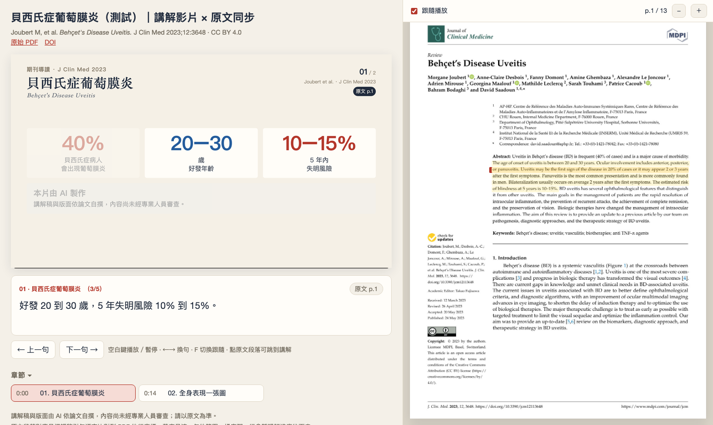
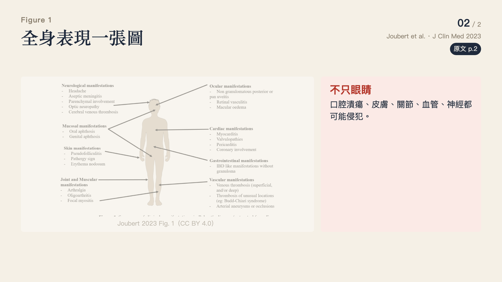

# paper-explainer · 論文講解影片 × PDF 原文同步

把一篇學術論文（PDF）做成**繁體中文講解影片**，並和**原文 PDF 逐句同步**：影片講到哪一句，右邊原文就捲到那一段並標黃；點原文的黃底段落，影片會跳回講解那一句。



| 一句一狀態：數字逐句浮現 | 論文圖表可直接放進投影片 |
|---|---|
|  |  |

> 範例內容：Joubert M, et al. *Behçet's Disease Uveitis.* J Clin Med 2023;12:3648（CC BY 4.0）。

*English summary: turns a paper PDF into a narrated Traditional-Chinese explainer video plus a player page where the original PDF scrolls and highlights in sync with each narrated sentence. Works with Claude Code, Codex, Gemini CLI, or chat assistants (ChatGPT / Claude.ai / Gemini) that write the script while a local one-liner builds the video.*

---

## 三種用法

### A. 用聊天型 AI（ChatGPT、Claude.ai、Gemini）——最簡單

1. 上傳論文 PDF，貼上 [`chat/PROMPT.md`](chat/PROMPT.md) 的提示詞。
2. AI 會**先摘要、問你幾個問題、給大綱讓你確認**，再輸出 `paper.json` 和 `script.json`。
3. 在你的電腦跑：

```bash
python3 scripts/pe.py init 我的專案 --pdf 論文.pdf
# 把 AI 給的 paper.json、script.json 存進「我的專案/」
python3 scripts/pe.py check 我的專案
python3 scripts/pe.py all 我的專案
python3 scripts/pe.py serve 我的專案 8790      # 打開 http://localhost:8790/
```

4. 若 `anchors` 說某幾句找不到原文，把錯誤訊息貼回對話，請 AI 修正。

### B. 用會跑指令的 AI agent（Claude Code、Codex、Gemini CLI）

安裝成 skill 後直接說：「用 paper-explainer 把這篇論文做成講解影片跟 PDF 同步播放頁」。
agent 會照 [`SKILL.md`](SKILL.md) 的流程自己讀論文、寫講稿、對錨點、出片、檢查。

```bash
git clone https://github.com/Tim090577/paper-explainer.git
cd paper-explainer && ./install.sh        # 連到 ~/.claude/skills、~/.codex/skills、~/.agents/skills
```

Gemini CLI 會讀 [`GEMINI.md`](GEMINI.md)、Codex 會讀 [`AGENTS.md`](AGENTS.md)，兩者都指向同一份 SKILL.md。

### C. 自己手動

照 [`SKILL.md`](SKILL.md) 的流程，講稿格式見 [`references/script-format.md`](references/script-format.md)。

---

## 生產原則：簡潔、重點清楚、沒有 AI 味

[`references/style-principles.md`](references/style-principles.md) 濃縮自 huashu-design（反 AI slop）、video-production（教學與念稿風格）與 exam-explainer-video（配音後製）：

- **一幕一個重點，一句一件事**；先講結論再給數字，數字只留會推進故事的
- **焦點以外的元素自動變淡**，觀眾永遠知道現在在看哪裡
- **不要 AI 味的視覺**：emoji、左色條卡片、漸層背景、自畫插圖、假數據
- **念稿寫給耳朵**：數字寫念法、不用括號、一句 15–35 字；配音預設套溫和後製

## 需要什麼

| 項目 | 說明 |
|---|---|
| Python 3.9+ | 加 PyMuPDF：`pip install pymupdf`（或 `uv run --with pymupdf python scripts/pe.py …`） |
| ffmpeg | 合成影片 |
| Google Chrome／Chromium | 截投影片（路徑特殊時設 `CHROME` 環境變數） |
| 配音（擇一） | macOS 內建 `say`（預設 Meijia 繁中）、自己錄音、或接任何 TTS 指令 |

跑 `python3 scripts/pe.py doctor` 檢查。目前在 macOS 上開發與測試；Linux／Windows 需自備 TTS（`command` 或 `files` 引擎）。

## 配音：預設繁中自然語音，也可自己配

`paper.json` 的 `voice.engine`：

- `say`（預設）：macOS 本機繁中語音 Meijia，不外傳。
- `files`：真人錄音。`pe.py export` 會產生念稿清單，每句錄一檔放 `voice-in/01.wav`…
- `command`：接你自己的 TTS（BreezyVoice、ElevenLabs、Azure…），用 `{text_file}`、`{out}` 參數。
- `edge`：微軟線上神經語音（zh-TW-HsiaoChenNeural），很自然但會外傳文字，且服務偶爾拒絕連線。
- `none`：靜音草稿，先看節奏。

細節見 [`references/voice.md`](references/voice.md)。換配音只要從 `voice` 往後重跑，講稿不用動。

## 產出

```
我的專案/
  index.html        播放頁（左：影片＋字幕＋章節；右：原文同步）
  video/video.mp4   講解影片，另有 subtitles.vtt／.srt
  pdf/              原文頁面圖
  data/cues.json    每一句的時間與 PDF 行框
  publish/          pe.py publish 打包的靜態網站（加 --artifact 可上傳 claude.ai Artifact）
```

## 注意事項

- **版權**：只有開放授權（如 CC BY）的論文才能公開散布 PDF 頁面圖與原文圖表；其他論文請只在本機使用。
- **內容正確性**：講稿由 AI 撰寫，所有數字都必須有原文錨點；醫學或專業內容請由專業人員審查後再分享。
- **隱私**：不要在講稿或配音放入病人或任何可識別個人的資料，尤其使用雲端 TTS 時。
- 本機預覽請用 `pe.py serve`；`python3 -m http.server` 不支援影片拖曳跳轉。

## 授權

程式碼以 MIT 授權釋出（見 [LICENSE](LICENSE)）。範例截圖中的論文內容與圖一屬原作者，依 CC BY 4.0 使用。
